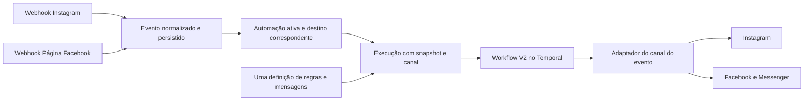

# Plano de automações compartilhadas entre Instagram e Facebook

Data: 19/10/2026. Base inspecionada: `main`, commit `b6686fe0`.

**Estado do documento original: plano aprovado. Implementação iniciada em 19/10/2026 pela etapa 0.** O [registro de implementação](facebook-instagram-implementation-progress.md) distingue código/testes já preparados da prova Meta real ainda pendente; não considerar as seções de proposta abaixo como funcionalidades entregues. A decisão de produto é priorizar a **opção 2**: uma automação, com configuração compartilhada e publicações selecionadas separadamente no Instagram e no Facebook. A opção 1, automações separadas por canal na mesma área, é alternativa somente diante de impedimento concreto registrado na fase de viabilidade.

## 1. Resultado esperado e decisões já tomadas

Uma pessoa comenta em uma publicação selecionada. A Meta entrega o webhook, o MultiPost identifica o canal e a automação, verifica as regras e envia a resposta naquele canal. Um comentário no Facebook recebe a mensagem no Messenger; um comentário no Instagram recebe a mensagem no Instagram. O evento nunca dispara uma mensagem no outro canal.

Decisões confirmadas na conversa:

- Primeira entrega para comentários em publicações orgânicas de Páginas do Facebook, incluindo publicações feitas fora do MultiPost.
- Link na primeira mensagem privada, sem exigir clique intermediário.
- Resposta pública opcional, com texto personalizável.
- Seleção de posts seguindo a experiência existente no Instagram.
- Regras existentes do Instagram como referência, inclusive palavras-chave, repetição e ativação.
- Uma configuração compartilhada para Instagram e Facebook quando tecnicamente possível; não trocar para a opção 1 apenas por ser mais simples.
- Presença de Manychat ou outro bot não é requisito de cadastro nem condição de produto. A coexistência não foi definida. Não implementar controle de bots de terceiros, handover ou troca automática de aplicativo principal.
- Testes automatizados e documentação detalhada fazem parte da entrega, não são tarefas opcionais ao final.
- Orientação de 21/10: a instalação e a configuração serão ensinadas a alunos. A jornada normal deve ser reproduzível pelos painéis Meta/MultiPost, sem agente, terminal, arquivo privado de token ou chamada avulsa à Graph API. Ações que o MultiPost ainda não automatiza precisam ser apresentadas como pendências de implementação ou ensinadas explicitamente pelo painel, sem etapa oculta executada pelo agente.

No comportamento atual, deduplicação é por automação e comentário, não por pessoa/publicação. Outro comentário da mesma pessoa pode gerar nova execução. Ativar uma automação não busca comentários antigos; eventos recebidos enquanto ela está ativa são elegíveis, inclusive entregas atrasadas. Vincular um comentário do Inbox não o reexecuta. Preservar essas distinções e respeitar a elegibilidade de envio da Meta.

### Limites da primeira entrega

O fluxo compartilhado atende `comment_on_post`, posts selecionados, palavras-chave, condições, resposta pública e uma resposta privada com link. O editor visual deve continuar permitindo os nós comuns compatíveis, inclusive atraso dentro da janela de envio validada.

Stories, reações de story, exigência de seguir o perfil e postbacks de follow-gate continuam disponíveis no Instagram existente. Não traduzir silenciosamente esses recursos para Facebook, nem removê-los das automações atuais. No fluxo compartilhado, tentar usar recurso incompatível deve mostrar o motivo e impedir a ativação; nunca ignorar a configuração.

O cenário principal e os exemplos usam posts selecionados (`specific`), como solicitado. Preservar também as modalidades existentes `all` e `next_publication` na experiência compartilhada, representadas por destino e sujeitas à prova de contrato Facebook. Não retirar modalidades do Instagram. Para `next_publication`, manter o vínculo no evento de publicação do MultiPost e o fallback lazy de evento recebido usado pelo Instagram, agora por destino; documentar essa semântica real, sem prometer que sempre identifica cronologicamente a próxima publicação externa. Anúncios, dark posts, grupos, perfis pessoais, respostas de stories do Facebook, sequências promocionais e sincronização de contatos entre redes ficam fora do escopo inicial.

## 2. Evidências do código atual

Os caminhos desta seção apontam para arquivos existentes, relativos à raiz do repositório. Novos nomes propostos aparecem explicitamente nas seções seguintes.

| Área | Fonte atual | Consequência para a implementação |
|---|---|---|
| Modelo | `libraries/nestjs-libraries/src/database/prisma/schema.prisma`, modelos `Flow`, `FlowExecution`, `PendingPostback`, `FlowMediaAlias` | `Flow.integrationId` é singular e obrigatório; a execução usa campos `ig*`. Seleção múltipla não pode ser apenas alteração de tela. |
| Entrada | `apps/backend/src/api/routes/ig-webhook.controller.ts` | Já valida assinatura, ignora eventos próprios e interpreta comentários/stories/postbacks. Aceitar formato `feed` não habilita Facebook: a resolução das integrações filtra Instagram. |
| Regras e persistência | `libraries/nestjs-libraries/src/database/prisma/flows/flows.service.ts` e `flows.repository.ts` | Seleção de flows ativos, posts, aliases, criação de execução e start Temporal assumem canal único. |
| Execução | `apps/orchestrator/src/workflows/flow.execution.workflow.ts` | Percorre grafo, avalia condições e acumula textos para uma única DM ao final. Prefere a integração salva no Flow. |
| Envio | `apps/orchestrator/src/activities/flow.activity.ts` | Seleciona explicitamente provider Instagram; não pode receber Facebook sem adaptação. |
| Roteamento Instagram | `libraries/nestjs-libraries/src/integrations/social/instagram-route.resolver.ts` | Escolhe host/token conforme conexão e credenciais; deve continuar sendo a fonte de decisão do Instagram. |
| Facebook | `libraries/nestjs-libraries/src/integrations/social/facebook.provider.ts` | Publicação e `comment()` já existem; resposta privada e configuração da automação não. Os scopes atuais não incluem `pages_messaging`. |
| Interface | `apps/frontend/src/components/automations/` | Assistentes, builder, histórico, Inbox e seleção de posts são reaproveitáveis, mas filtros e modelos são específicos do Instagram. |
| Contratos | `libraries/nestjs-libraries/src/dtos/flows/flow.dto.ts`, `apps/backend/src/public-api/routes/v1/public.flows.controller.ts` | APIs e consumidores existentes precisam continuar funcionando. |
| Operação | `package.json`, `Dockerfile.dev`, `StartupMigrationService` | O boot atual pode executar `prisma db push --accept-data-loss`; rollout e rollback precisam de proteção antes de expandir o schema. |

### Diferenças existentes que não devem ser copiadas inadvertidamente

1. O assistente edita variações de resposta pública; o builder edita outro campo. A configuração efetiva não pode divergir entre telas na V2.
2. `quickUpdate` reconstrói um grafo linear e pode perder nós de um fluxo avançado. A V2 precisa de roundtrip sem perda ou de bloqueio explícito da edição simplificada quando não representável.
3. A resposta pública pode sair antes da confirmação da DM. Não apresentar texto automático de sucesso ou estado concluído quando o envio privado falhou.
4. A consulta de deduplicação seguida de inserção não tem a proteção necessária contra concorrência. A V2 precisa de reserva atômica.
5. Quick-create e ativação manual não percorrem exatamente a mesma verificação de webhook. A V2 terá um único serviço de validação e ativação.
6. Algumas consultas de histórico/Inbox/aliases não carregam o perfil até a consulta final. Toda nova rota ou consulta reaproveitada deve validar organização, perfil, automação e canal juntos.
7. O estado de um `PendingPostback` expirado e o estado da execução podem divergir. Preservar o processamento legado e registrar a correção como trabalho separado, salvo se indispensável a um teste de regressão da área alterada.

## 3. Viabilidade Meta e critérios de fallback

A [documentação de Private Replies da Meta](https://developers.facebook.com/docs/messenger-platform/discovery/private-replies) descreve Page Access Token, `pages_messaging` e envio por `POST /PAGE-ID/messages`, com `recipient.comment_id`. Também distingue a primeira resposta privada da continuação da conversa. A primeira resposta tem elegibilidade temporal própria; enviar uma mensagem não abre automaticamente autorização para mensagens seguintes.

A página consultada traz exemplo de versão antiga. Usar as constantes atuais do projeto em `meta-graph.constants.ts`, não copiar a versão do exemplo. A documentação confirma o mecanismo, mas não comprova permissões concedidas ao app ou funcionamento de uma Página específica.

Antes da implementação completa, executar uma prova vertical pequena em ambiente de desenvolvimento/homologação, com Página e conta de teste autorizadas:

- Confirmar os scopes e níveis de acesso necessários para ler publicações/comentários, assinar o webhook da Página e enviar resposta privada/pública. Validar também `pages_manage_metadata` e `pages_read_user_content` conforme os endpoints efetivamente usados; não assumir que a lista de publicação basta.
- Confirmar Page Access Token e tarefa de messaging do usuário/ativo; distinguir autorização concedida, assinatura do aplicativo e assinatura da Página.
- Receber payload real sanitizado de comentário orgânico: IDs da Página, post, comentário, autor, timestamp, `item` e `verb`. Verificar comentários em foto, vídeo/Reel e publicação com várias fotos; documentar formatos efetivamente suportados.
- Enviar texto com URL e botão URL na primeira resposta privada. Confirmar limites efetivos de corpo/título e o que ocorre quando outra resposta privada já foi consumida.
- Testar comentário novo da mesma pessoa no mesmo post e em outro post. Se a Meta restringir repetição, registrar a restrição por canal e impedir tentativas inelegíveis; não prometer paridade com base apenas no comportamento interno do Instagram.
- Confirmar eventos de edição/remoção, comentários da própria Página e respostas a outros comentários. Processar somente comentários novos elegíveis; definir a normalização da publicação raiz com fixture real, sem confundir ID de foto com ID do post selecionado.
- Validar `all` e o vínculo único de `next_publication` por destino, tanto após publicação pelo MultiPost quanto pelo fallback de webhook. Se algum modo não puder ser oferecido no Facebook, expor a capacidade indisponível sem afetar IG e registrar o impedimento no plano antes de reduzir o escopo.
- Não alterar roteamento ou desligar aplicativos de terceiros. Se uma configuração real impedir envio, mostrar diagnóstico específico de integração. A aplicação não pode garantir independência absoluta de configurações externas da Meta.

**Portão de saída:** fixture real sanitizada, request/response sem segredos, conjunto de permissões documentado e teste de uma execução completa. A prova não autoriza publicações ou mensagens em contas de produção não destinadas ao teste.

**A opção 2 permanece preferida** se as mesmas regras/textos puderem ser executados por adaptadores separados. Tokens diferentes, IDs distintos e permissões por canal são diferenças esperadas, não motivos de fallback. Recursos exclusivos de Instagram não inviabilizam o conjunto comum.

Considerar opção 1 somente se a prova demonstrar que a configuração compartilhada não pode expressar o comportamento comum sem perda silenciosa, ou que a compatibilidade/migração não pode ser preservada com a estratégia abaixo. Registrar evidência, impacto e alternativa antes de mudar o plano. Falta de permissão Messenger bloqueia Facebook nas duas opções e não justifica, sozinha, mudar para a opção 1.

## 4. Arquitetura proposta

Separar **definição**, **destinos** e **execuções**. Um único Flow contém mensagens e regras. Cada destino contém uma integração e suas publicações. Cada evento gera execução somente para o destino em que ocorreu.



### 4.1 Modelo de dados aditivo

Nomes abaixo são propostas de novos modelos/campos, não estruturas já implementadas.

| Estrutura | Dados propostos e invariantes |
|---|---|
| `Flow` | Adicionar `definitionVersion`, `executionVersion` (default legado) e revisão monotônica de configuração. Preservar `integrationId`, `triggerPostIds`, nós/arestas e relacionamentos legados durante a transição. |
| `FlowChannel` | `id`, `flowId`, `integrationId`, `postMode`, `postIds`, status operacional e timestamps. Unique `(flowId, integrationId)`. Canal, organização e perfil derivados/validados no servidor; identificadores remotos nunca identificam sozinhos um tenant. |
| `FlowExecutionV2` | Nova tabela com `flowId`, `flowChannelId`, organização/perfil, `integrationId`, `platform`, `externalEventId`, `externalPostId`, `externalActorId`, `definitionRevision`, snapshot e estado V2. Manter `FlowExecution` legado intacto: campos obrigatórios `igCommenterId`/`igMediaId` não receberão IDs Facebook nem serão tornados nulos para contornar o contrato antigo. |
| `AutomationEvent` | Evento normalizado mínimo e sanitizado; unique `(integrationId, eventType, externalEventId)`, `occurredAt`, `receivedAt` e estado de despacho. Guardar apenas dados necessários à automação; sem token, assinatura ou payload bruto irrestrito. |
| `AutomationDispatch` | Reserva da execução por `(flowId, flowChannelId, eventId)` com unique no banco, estado e ID determinístico do workflow; associação à execução V2 quando criada. Reservas `LEGACY_HANDLED` podem referenciar execução legada e nunca são despachadas. Permite recuperar falha entre persistência e start Temporal e preservar deduplicação após conversão. |
| `FlowDelivery` | Efeito de envio V2 por `(executionV2Id, actionKey)` com unique, estados `PLANNED`, `SENDING`, `SENT`, `FAILED`, `UNKNOWN`, IDs remotos e erro sanitizado. A chave distingue resposta pública e DM agregada. |

Adicionar índices para consultas por integração, estado e data. O schema físico final e índices devem ser revisados com o plano de consultas antes de migrar. Fixtures históricas precisam incluir flows pausados, removidos, com aliases e com follow-gate pendente. Enquanto um flow for legado, os campos atuais continuam sendo a fonte de verdade para posts/modos: a projeção de leitura V2 deriva deles, e não da cópia preparatória em `FlowChannel`. Na conversão, atualizar o destino dentro da transação a partir do estado legado mais recente. Isso evita exigir dual-write em activities legadas em andamento.

Na primeira V2, aceitar um ou dois destinos do mesmo perfil: até uma conta Instagram e uma Página Facebook. Não unir organizações/perfis nem inferir identidade de pessoas entre redes. Ampliar para várias contas da mesma rede será evolução explícita.

Em flows V2, `Flow.integrationId` permanece apenas como referência legada estável; **não decide o canal de envio**. A execução usa exclusivamente seu `flowChannelId`/`integrationId` validado. Limites, mídias e estado de conexão pertencem ao destino; textos e palavras-chave pertencem à definição compartilhada.

### 4.2 Adaptadores e capacidades

Introduzir contrato interno `CommentAutomationAdapter` com operações de capacidades, listagem de posts, verificação de prontidão, resposta pública e privada. Implementações propostas: `InstagramCommentAutomationAdapter` e `FacebookCommentAutomationAdapter`, delegando aos providers/serviços existentes quando possível.

- O adaptador Instagram usa `resolveIgRoute`; não substituir seleção de host/token por lógica genérica da Meta.
- O adaptador Facebook usa Page token da integração correta. Não consultar tokens de Instagram para preencher permissões ausentes de Messenger.
- OAuth preserva `ClientInformation` e credenciais por perfil. Alteração de scopes pode exigir nova autorização; a UI deve distinguir conectado para publicar de pronto para automação.
- Capabilities expressam gatilhos, ações, botões, modos de seleção e limites confirmados. Recursos compartilhados são a interseção das capacidades dos destinos.
- `story_reply`/`requireFollow` permanecem exclusivos do caminho Instagram existente nesta entrega. Não desligar automaticamente um gate ao adicionar Facebook.
- Validar no backend e na UI, com o mesmo contrato; não truncar silenciosamente texto/título para contornar limites.

A camada HTTP permanece Controller → Service → Repository. Serviços e regras novas ficam em `libraries/nestjs-libraries/src/`; activities são wrappers finos. Providers novos, se necessários, seguem `SocialAbstract`/`SocialProvider`; os adaptadores internos não serão registrados como novos canais publicáveis.

### 4.3 Eventos, despacho e entrega

1. Endpoint Facebook proposto: `GET/POST /public/fb-webhook`, separado do endpoint Instagram existente. Registrar em `ApiModule.controllers` fora da lista `authenticatedController`, seguindo o webhook atual; `rawBody: true` já existe no bootstrap. Não criar bypass genérico de `/public` nos guards. A rota é pública por autenticação de sessão, mas exige verificação de assinatura para eventos.
2. Validar handshake e HMAC SHA-256 com segredo do app autorizado para a Página/perfil identificado. Em lote com várias Pages, um segredo válido para uma não autoriza processar as demais. Ignorar ou rejeitar eventos não reconhecidos conforme contrato documentado.
3. Normalizar para `{ platform, integrationId, pageOrAccountId, postId, commentId, authorId, authorName?, text, occurredAt?, receivedAt }`. Não usar `authorId` de Facebook como IG-scoped ID.
4. Separar roteamento por `executionVersion` antes de qualquer start. O matcher legado deve excluir Flow V2, mesmo que conserve `integrationId` e status ACTIVE; o matcher V2 só aceita V2. Um evento IG pode atender flows distintos em motores distintos, mas nunca iniciar os dois motores para o mesmo flow. Selecionar destinos elegíveis e persistir evento, reservas de despacho e snapshot de configuração de forma atômica. O snapshot fixa as regras no recebimento, preservando a semântica de automação ativa naquele momento. Edição posterior não muda uma execução em espera.
5. Responder sucesso ao webhook após persistência durável; falha de persistência responde erro recuperável. Eventos desconhecidos/ineligíveis recebem resposta apropriada sem gerar envio.
6. Despachar para Temporal com ID determinístico por reserva. Recuperação de reservas pendentes por `automationDispatchWorkflow` proposto, reconciliado no boot via `StartupMigrationService`; usar fila `main`, ciclos limitados, backoff e `continueAsNew`. Start repetido encontra o workflow existente, não cria outro.
7. Novas entregas usam ledger e políticas distintas de retry. Leituras podem repetir; mutações não recebem retry cego após timeout ou perda de resposta. Sucesso conhecido não é enviado novamente. Resultado remoto desconhecido vira `UNKNOWN`, visível no histórico, e só é conciliado se a API permitir verificar o resultado.
8. O ledger não promete exatamente uma entrega remota em todas as falhas. Testar e documentar a janela em que o remoto aceitou a mensagem e o processo caiu antes de gravar o sucesso.
9. Remover/pausar destino cancela despachos ainda não iniciados; execuções em andamento verificam elegibilidade antes de cada novo efeito. Efeito já enviado permanece no histórico. Falha do Facebook não interrompe execuções independentes do Instagram.

Na V2, os nós de DM continuam agregando uma única resposta privada. Condições e atrasos são calculados antes do envio; o atraso não pode ultrapassar a elegibilidade restante da primeira resposta privada. Não adicionar follow-up sem interação do destinatário. A resposta pública configurada permanece opcional; sua ordem de execução será explícita no grafo e no histórico. O produto não deve gerar automaticamente confirmação “enviei” antes de confirmar o envio privado.

Uma pessoa comentando nas duas redes pode receber uma mensagem em cada rede. Não há deduplicação entre identidades de Instagram e Facebook. Mais de uma automação aplicável ao mesmo comentário mantém inicialmente a seleção existente, mas a elegibilidade da única resposta privada precisa ser coordenada por comentário/canal para não gerar envios concorrentes incompatíveis; a fase de prova deve fixar o contrato dessa disputa antes de habilitar sobreposição na V2.

### 4.4 Temporal e proteção das execuções existentes

Criar `flowExecutionV2Workflow` e activities V2 com nomes próprios. Manter `flowExecutionWorkflow`, `followGateResolveWorkflow` e suas activities compatíveis. Usar novo nome de workflow não protege activities antigas se suas implementações forem modificadas de forma incompatível.

Entradas e resultados de workflow carregam IDs e dados permitidos; credenciais são carregadas/descriptografadas somente nas activities. Não incluir token, segredo ou objeto `Integration` completo em históricos Temporal. I/O, relógio de negócio e escolha persistida de variação de mensagem ficam em activities/serviços; o workflow é determinístico.

Todos os workers que fazem polling de `main` devem reconhecer V2 **antes** de o backend iniciar V2. Não misturar pollers antigos incapazes de executar o novo tipo na mesma fila após a habilitação.

Flows legados continuam no motor antigo. Conversão explícita de um flow simples para compartilhado exige flow pausado, ausência de execução RUNNING/WAITING_POSTBACK ou despacho pendente e validação completa dos dois destinos. Verificação e troca de versão devem ser serializadas com a reserva de eventos para evitar corrida. Preservar ID e histórico; não converter gates/stories automaticamente. Se não for representável, orientar criação de outra automação sem alterar a original.

Antes da conversão, criar recibos `LEGACY_HANDLED` para comentários que já possuem execução legada naquele flow/destino, inclusive execuções falhas, preservando a deduplicação atual. Reentrega do mesmo comentário depois da conversão não pode gerar novo envio V2. Não inventar timestamp do comentário ausente no histórico: manter origem/proveniência dos campos e `occurredAt` desconhecido. A projeção de histórico da API V2 une as duas tabelas com discriminador de versão, sem alterar registros legados.

## 5. Contrato de API antes da interface

Preservar `/flows` e `/public/v1/flows` com seus payloads legados. Criar rotas V2 explícitas: `/flows-v2` na API interna e `/public/v2/flows` na pública. Não tornar `integrationId` opcional na DTO V1 e esperar que clientes antigos compreendam `channels`.

### Payload proposto de criação/edição simples V2

```json
{
  "name": "Material gratuito",
  "triggerType": "comment_on_post",
  "channels": [
    { "integrationId": "canal-instagram", "postMode": "specific", "postIds": ["ig-media-id"] },
    { "integrationId": "pagina-facebook", "postMode": "specific", "postIds": ["page_post-id"] }
  ],
  "rules": { "keywords": ["QUERO"], "matchMode": "any" },
  "actions": {
    "publicReply": { "enabled": true, "messages": ["Confira sua mensagem privada."] },
    "privateReply": {
      "text": "Aqui está o material solicitado.",
      "button": { "label": "Acessar material", "url": "https://example.com/material" }
    }
  },
  "expectedRevision": 0,
  "activateOnSave": true
}
```

O perfil vem do contexto autorizado, não é confiado ao corpo. `expectedRevision=0` é exclusivo de criação; edição exige a revisão retornada pelo servidor. Provider é derivado da integração. `postIds` são obrigatórios em `specific` e validados no canal, sem aceitar publicação de outra Página; `all` e `next_publication` não exigem lista inicial. `activateOnSave=true` permite salvar e ativar no mesmo gesto, preservando a experiência do wizard atual, mas passando pelo serviço único de prontidão/ativação. Falha de validação não cria ACTIVE parcial; `false` permite salvar rascunho. Edição preserva ACTIVE/PAUSED e só promove DRAFT quando a intenção de ativar foi enviada. Os exemplos são contratos propostos, não endpoints disponíveis.

### Endpoints e respostas

| Método e rota interna | Contrato |
|---|---|
| `POST /flows-v2` | Criar e retornar `{ id, revision, executionVersion, status, channels, definition, readiness }`. |
| `GET /flows-v2` / `GET /flows-v2/:id` | Listar/detalhar com canais, revisão e capacidades; ler legados por projeção somente leitura compatível. |
| `PUT /flows-v2/:id` | Editar definição simples + destinos atomicamente, com controle de revisão. Não apagar grafo avançado. |
| `PUT /flows-v2/:id/canvas` | Salvar grafo e configuração canônica comum; validar recursos de todos os destinos. |
| `POST /flows-v2/:id/status` | Ativar/pausar/arquivar; ativação valida todos os destinos solicitados. Falha retorna diagnóstico e mantém estado anterior. |
| `DELETE /flows-v2/:id` | Exclusão lógica, interrompendo novos despachos e preservando histórico. |
| `POST /flows-v2/:id/convert` | Converter legado elegível pausado, com `expectedRevision` e destinos; rejeitar execução pendente ou recurso incompatível. |
| `GET /flows-v2/integrations/:id/posts` | `{ items: [{ id, caption, thumbnailUrl?, permalink?, mediaType }], nextCursor }`, paginado e escopado. |
| `GET /flows-v2/integrations/:id/readiness` | Diagnóstico sem segredos: token, permissões, subscription do app/Página, capacidades e ação necessária. |
| `GET /flows-v2/:id/executions` / `GET /flows-v2/:id/executions/:executionId` | Canal, comentário, etapas, efeito confirmado/falha/resultado desconhecido e erro sanitizado. |

A API pública V2 oferece CRUD, status, canvas, conversão, posts, readiness e histórico correspondentes, sob os mesmos limites e autenticação por chave de organização/perfil. A URL pública de webhook continua independente das APIs autenticadas.

Regras de compatibilidade:

- V1 continua criando e operando flows legados sem alteração obrigatória de clientes.
- Listas V1 retornam flows de representação V1; objetos V2 não são projetados como se tivessem um único destino. A documentação deve declarar essa delimitação.
- Acesso por ID V1 a flow convertido/V2 retorna `409 FLOW_REQUIRES_V2`, sem leitura enganosa nem gravação destrutiva. A conversão deve informar essa consequência antes de ser aplicada.
- Na UI unificada, flows legados permanecem editáveis pelo caminho atual; V2 usa DTOs novas. Não migrar todos os flows durante uma leitura.
- SDK, CLI e MCP recebem operações V2 explícitas; as funções atuais preservam seus contratos. Não encaminhar implicitamente método antigo ao primeiro canal.
- Erros: `400` payload inválido/recurso incompatível; `403` escopo ou papel sem acesso, sem limpar sessão; `409` revisão/versão/estado conflitante; `412` configuração de canal incompleta. Nunca usar 402 para credenciais.
- Readiness é observação, não garantia de entrega futura. Distinguir `ready`, `needs_action` e `unknown`; indisponibilidade de diagnóstico não vira falso sucesso.

## 6. Experiência de configuração e histórico

Manter a área atual de Automações. Uma linha/cartão representa a automação compartilhada e mostra os canais vinculados.

1. Escolher Instagram, Facebook ou ambos, dentro do perfil atual.
2. Selecionar posts em uma seção de cada canal, com prévia e nome da conta/Página; manter as opções de todos/próxima publicação existentes. Não associar automaticamente publicações apenas porque legenda ou mídia são iguais.
3. Configurar uma vez palavras-chave, variações de resposta pública e mensagem privada/link.
4. Mostrar prévias por rede e recursos disponíveis conforme a interseção de capacidades.
5. Preservar o gesto de salvar/ativar do wizard, apresentando prontidão por canal e usando validação unificada. Ativar somente quando os destinos estiverem aptos; permitir salvar rascunho sem ativar. Edição de uma automação pausada não a reativa implicitamente. Erro de um canal não pode ser ocultado por sucesso do outro.
6. Histórico consolidado com filtro por canal e detalhe de cada execução; nunca usar “concluído” para DM rejeitada ou resultado desconhecido.

Wizard e builder devem consumir normalizadores/serializadores compartilhados, sem duplicar regras de capabilities. A edição simples não pode descartar nós avançados: usar transformação comprovadamente sem perda ou orientar continuar no builder. Preservar seleção de posts, variações, condição e CTA ao alternar telas e reabrir.

Chaves novas propostas, em pt/en, via `useT()`: `automation_channels`, `automation_select_posts_by_channel`, `automation_shared_settings`, `automation_channel_not_ready`, `automation_feature_not_supported`, `automation_requires_reauthorization`, `automation_execution_channel`, `automation_delivery_unknown`, `automation_revision_conflict`, `automation_conversion_requires_pause`, `automation_conversion_requires_v2_clients`. Reutilizar chaves existentes quando houver equivalência.

### 6.1 Configuração reproduzível pelo aluno — requisito de 21/10

**Estado observado antes deste incremento:** o `FacebookProvider` já trocava o código de login por token, fazia a troca por autorização de maior duração e obtinha os tokens das Páginas na seleção do canal. A lista de scopes era de publicação/leitura; não incluía `pages_messaging`, `pages_manage_metadata` ou `pages_read_user_content`. A inscrição em `FlowsService.ensureWebhookSubscription` permanece exclusiva do Instagram. O novo onboarding Facebook usa serviço e callback próprios, descritos no [plano específico](facebook-automation-panel-onboarding.md), sem reutilizar o callback Instagram de `/flows/webhook-config`.

**Jornada prevista:** configuração, autorização e diagnóstico implementados neste incremento; a prova real e o motor de respostas permanecem pendentes.

1. O administrador da instalação configura o aplicativo no painel da Meta, habilita os recursos necessários e atende aos requisitos de acesso que o caso real exigir. O material didático deve mostrar os campos de domínio/redirect/callback efetivamente utilizados e distinguir estado de teste de disponibilidade para outras pessoas. Não prometer que o aplicativo poderá dispensar aprovação da Meta.
2. Em Credenciais do MultiPost, cadastra App ID/Secret do aplicativo no perfil autorizado. O painel apresenta o callback Facebook e seu token de verificação; explica que esse token de verificação é distinto do token de acesso à Página. O cadastro do callback poderá ser executado por ação explícita no MultiPost, com leitura/validação do estado remoto e proteção contra substituir callback de outra instalação. Se houver etapa necessariamente manual na Meta, fornecer instruções verificadas pelo painel.
3. No MultiPost, conecta ou reautoriza o Facebook pelo login e seleciona a Página desejada. O próprio servidor obtém e guarda o token; não exigir geração no Graph API Explorer nem cópia de access token pelo aluno. A autorização adicional de automação deve preservar o uso de quem só publica e distinguir permissão recusada de token inválido.
4. Ao habilitar automação para a Página, o MultiPost confere o aplicativo, a Página, as permissões e a inscrição do webhook; registra `feed` apenas para o destino escolhido, preservando outros campos existentes. Ter várias Páginas autorizadas no mesmo aplicativo não inscreve nem ativa automaticamente todas elas.
5. O painel mostra o estado real e a ação necessária: pronto, reconectar, completar configuração Meta ou falha de verificação. Não declarar sucesso apenas por haver App ID/Secret ou token no banco. O aluno escolhe o post, configura a resposta, ativa e confere um comentário de teste no histórico.

O token temporário e o receptor `/public/fb-webhook-proof` preparados na etapa 0 são ferramentas de desenvolvimento; não integram o procedimento final do aluno. O usuário escolheu priorizar o onboarding do MultiPost. O incremento usa `/public/facebook-automations/:appId` para configuração e diagnóstico, sem dispatcher de respostas; o contrato definitivo da seção 4.3 continua condicionado à implementação V2. Não apresentar a prova feita por chamadas avulsas como validação da jornada de instalação.

Aceite adicional da jornada: instalação limpa configurada pelos painéis; reautorização de Página já conectada para publicar; permissão negada/expirada com orientação clara; um aplicativo com várias Páginas e perfis sem inscrição/envio cruzado; callback preexistente preservado; execução de comentário de teste e histórico conferidos pela UI. Automatizar as verificações de contrato/isolamento e registrar também o ensaio manual, sem credenciais em screenshots. Os testes técnicos isolados não substituem esse aceite.

## 7. Sequência de implementação e entregáveis

Cada etapa segue RED → GREEN → REFACTOR. A passagem de etapa depende dos testes e evidências, não só de compilação.

| Etapa | Trabalho | Critério de saída |
|---|---|---|
| 0 — Baseline e prova Meta | Registrar suítes existentes, fixtures de IG e prova Facebook da seção 3; fechar limites/capabilities e disputa entre flows no mesmo comentário. | Mecanismo vertical comprovado e falhas anteriores separadas de regressões. |
| 1 — Contratos e proteção de deploy | DTOs V2, respostas/erros, matriz de compatibilidade; proteção contra schema antigo destrutivo no boot; harnesses de teste ausentes. | Contratos testados, release de compatibilidade e plano de rollback ensaiado. |
| 2 — Modelo aditivo | `FlowChannel`, evento/despacho/entrega e contexto por execução; backfill idempotente sem mudar versões legadas. | Testes com banco real de migração, isolamento e concorrência aprovados. |
| 3 — Adaptadores | Extrair contrato comum; adaptar IG preservando resolver; implementar Facebook, listagem e readiness. | Testes de contrato iguais para ambos, com fixtures de requests/responses e erros. |
| 4 — Webhook e motor V2 | Entrada Facebook; despacho durável; workflow/activities V2; ledger; separação por canal; recuperação. | Testes ponta a ponta locais com Meta simulada e Temporal real, incluindo restart e falha ambígua. |
| 5 — Interface e consumidores | Wizard, builder, lista/histórico, credenciais, API pública V2, SDK/CLI/MCP. | Roundtrip sem perda, testes de UI e preservação de contratos V1. |
| 6 — Homologação e documentação | Prova real IG/FB, regressão de publicação/gates/stories, documentação final e revisão. | Critérios de aceite completos, evidências e rollout autorizado no processo normal do projeto. |

### Mapa de arquivos

Alterações previstas em arquivos existentes:

- `libraries/nestjs-libraries/src/database/prisma/schema.prisma`, `database.module.ts`, `startup-migration.service.ts` e specs.
- `libraries/nestjs-libraries/src/database/prisma/flows/flows.service.ts`, `flows.repository.ts`, `unmatched-comment.service.ts` e specs: compatibilidade, seleção por destino, chamadas e autorização. Evitar aumentar indefinidamente o serviço atual; concentrar V2 em novos serviços.
- `libraries/nestjs-libraries/src/integrations/social/facebook.provider.ts`, `instagram.provider.ts`, `instagram-route.resolver.ts` e specs somente onde necessário para o contrato comum, preservando consumidores de publicação.
- `apps/backend/src/api/routes/ig-webhook.controller.ts`, `flows.controller.ts`, `automations-inbox.controller.ts`, `api.module.ts`, `apps/backend/src/public-api/public.api.module.ts` e configuração de middleware/guards conforme o registro atual.
- `apps/orchestrator/src/workflows/index.ts`, `apps/orchestrator/src/app.module.ts`; manter workflows/activities legados compatíveis.
- `apps/orchestrator/src/activities/post.activity.ts`: chamada de vínculo `bindPendingFlowsToPost` é consumidor externo ao domínio de flows; separar o vínculo legado/V2 por versão e integração, sem fazer falha de binding derrubar publicação. Cobrir os caminhos de publicação versionados que chegam a essa atividade.
- `apps/frontend/src/components/automations/` e `src/components/settings/`; traduções em `libraries/react-shared-libraries/src/translation/locales/{pt,en}/translation.json`.
- `apps/sdk/src/index.ts`, `apps/cli/bin/multipost.js`, `apps/cli/SKILL.md`, `libraries/nestjs-libraries/src/agent/agent.skill.template.ts`, ferramentas em `libraries/nestjs-libraries/src/chat/tools/` e registro MCP em `src/chat/start.mcp.ts`. Manter paridade API ↔ CLI ↔ skill local ↔ guia servido em `/public/agent-skill`.
- `package.json`, `pnpm-lock.yaml`, `.github/workflows/build.yml`, entrypoints de container e `.env.example` para comandos/flags efetivamente adicionados.

Novos arquivos propostos (nomes podem ser ajustados antes de codificar, mantendo responsabilidade e cobertura):

| Arquivo/área nova | Responsabilidade e teste obrigatório |
|---|---|
| `libraries/nestjs-libraries/src/dtos/flows/flow-v2.dto.ts` | Contratos V2, schemas e validação; `.spec.ts`. |
| `libraries/nestjs-libraries/src/database/prisma/flows/flow-channels.repository.ts` | Destinos e isolamento; `.spec.ts` e integração de banco. |
| `libraries/nestjs-libraries/src/database/prisma/flows/automation-events.repository.ts` | Eventos/reservas atômicas e recuperação; `.spec.ts` + concorrência em banco. |
| `libraries/nestjs-libraries/src/database/prisma/flows/flow-delivery.repository.ts` | Ledger, estados e bloqueio de efeitos; `.spec.ts` + concorrência. |
| `libraries/nestjs-libraries/src/database/prisma/flows/flow-executions-v2.repository.ts` | Execuções novas e projeção explícita de histórico por versão; `.spec.ts` e integração de isolamento. |
| `libraries/nestjs-libraries/src/database/prisma/flows/flow-v2.service.ts` | CRUD, ativação, snapshots, conversão e autorização; `.spec.ts`. |
| `libraries/nestjs-libraries/src/database/prisma/flows/automation-dispatch.service.ts` | Despacho/reconciliação; `.spec.ts`. |
| `libraries/nestjs-libraries/src/integrations/automations/` | Contrato/capabilities e adaptadores IG/FB; specs co-localizadas para cada serviço/adaptador com lógica. |
| `libraries/nestjs-libraries/src/integrations/automations/facebook-automation-webhook.service.ts` | Validação/normalização/encaminhamento Facebook; `.spec.ts` com fixtures assinadas. |
| `apps/backend/src/api/routes/fb-webhook.controller.ts` e `flows-v2.controller.ts` | HTTP fino; specs de contrato/guards/HMAC/raw body. |
| `apps/backend/src/public-api/routes/v2/public.flows.controller.ts` | API pública V2; `.spec.ts`. |
| `apps/orchestrator/src/activities/flow-v2.activity.ts` | Wrappers para serviços V2; `.spec.ts`. |
| `apps/orchestrator/src/workflows/flow.execution.v2.workflow.ts` e `automation-dispatch.workflow.ts` | Orquestração determinística; `.spec.ts` com ambiente Temporal. |
| `apps/orchestrator/src/replay/automation-workflow-replay.ts` | Replay específico de automações; `.spec.ts`, script e comando documentado. |
| Harness frontend e E2E de automações | Configuração de testes, fixtures e specs da configuração compartilhada, sem dependência de sessão de produção. |

## 8. Testes automatizados obrigatórios

### 8.1 Baseline e infraestrutura real

Hoje `pnpm test` cobre backend e libraries; `pnpm test:orchestrator` é separado e já está no CI. Não há script `test:frontend` nem script `lint` no `package.json` da raiz inspecionado. As instruções do repositório exigem `pnpm lint`: resolver essa diferença com um comando real e documentado, executado da raiz, antes de usá-lo como gate. Não declarar uma suíte inexistente como aprovada.

O replay existente `pnpm temporal:replay-post` aceita workflows de publicação, não automações. Criar runner de automações e fixtures adequadas. Alguns testes atuais reproduzem helpers localmente: novos testes devem chamar implementação real, não uma cópia do algoritmo.

Adicionar harnesses explicitamente: React/Vitest para componentes e normalizadores; Playwright para jornadas; ambiente de integração com PostgreSQL/Redis isolados e servidor Temporal de teste/local. `@temporalio/testing`, se adotado, deve ter versão compatível com os pacotes Temporal instalados. Instalar somente via PNPM. Não usar banco ou credenciais de produção.

### 8.2 Matriz de regressão e aceite

| ID | Cenário | Evidência esperada |
|---|---|---|
| T01 | Flow IG legado, comentário correspondente | Resposta/DM e histórico equivalentes ao baseline. |
| T02 | IG via Facebook Login e via token standalone | Host e credencial corretos; sem troca de token por causa da V2. |
| T03 | Stories/reação e follow-gate legados | Caminhos preservados, inclusive clique em pending criado antes do deploy. |
| T04 | `any`, `all`, `exact`, comentário sem match | Sem mudança de semântica de caixa, substring, acentos e texto integral. |
| T05 | Uma configuração IG+FB, um comentário em cada rede | Uma execução por canal; mesmos textos; posts, tokens e destinatários não se cruzam. |
| T06 | Mesmo ID remoto em canais/perfis distintos | Nenhuma colisão de deduplicação ou acesso cruzado. |
| T07 | Webhook duplicado em paralelo | Uma reserva/execução; comprovar com banco real e unique, não apenas mock sequencial. |
| T08 | Outro comentário da mesma pessoa | Nova elegibilidade conforme contrato do canal; sem cooldown inventado. |
| T09 | Flow pausado, removido ou post não selecionado | Nenhum envio; sem busca retroativa de comentários na ativação. |
| T10 | Falha após persistir, antes do start Temporal | Reconciliador recupera; existência da reserva não bloqueia o envio para sempre. |
| T11 | Meta aceitou envio, resposta perdida | Resultado desconhecido; nenhuma repetição automática cega. |
| T12 | Resposta pública confirmada, DM rejeitada | Histórico por efeito, sem sucesso total nem repetição do público no retry. |
| T13 | 429, token inválido, permissão ausente, comentário removido/expirado | Classificação e tratamento apropriados, espera limitada por elegibilidade e nenhum token em erro/log. |
| T14 | Assinatura ausente/inválida, body modificado, lote com Pages de apps distintos | Rejeição/isolamento correto antes de qualquer persistência acionável ou envio. |
| T15 | Eventos próprios, eco, edição e remoção | Não acionam nova automação de comentário. |
| T16 | Comentário em foto/álbum/vídeo/Reel e resposta a comentário | Normalização do post e decisão de elegibilidade conforme fixtures reais da prova Meta. |
| T17 | Ativação com um destino inválido | Operação atômica; motivo por canal; nenhum ACTIVE enganoso. |
| T18 | Recurso exclusivo IG em flow compartilhado | Validação na UI/API; sem remoção silenciosa do gate/story. |
| T19 | Wizard → builder → salvar → wizard | Preserva mensagens, variações, posts por canal, CTA e condições; grafo não representável não é achatado. |
| T20 | Atualizações concorrentes da definição | Uma revisão vence; outra recebe 409; snapshot em execução não muda. |
| T21 | Roles VIEWER/EDITOR e chave por perfil | Escrita/leitura conforme autorização; histórico, posts, Inbox e aliases sem acesso entre perfis. |
| T22 | V1 via REST, SDK, CLI e MCP | Payloads antigos continuam; acesso a V2 rejeita explicitamente sem truncar destinos. |
| T23 | V2 via REST, SDK, CLI e MCP | Contratos equivalentes, erro validado e identificação do canal. |
| T24 | Atraso/restart do worker/replay legado e V2 | Sem não determinismo, sem envio repetido conhecido, sem secrets no histórico. |
| T25 | Backfill repetido e parcialmente interrompido | Idempotência, contagens reconciliadas, nenhum flow legado ativado/convertido. |
| T26 | Rollback com schema expandido e V2 pendente | Novos starts cessam; workers capazes drenam; dados permanecem; nenhum db push destrutivo. |
| T27 | Publicação Facebook e Instagram existente | Feed/foto/vídeo/story e recuperação de token não regridem por alteração de provider/scopes. |
| T28 | Histórico UI, loading/erro/vazio, pt/en, teclado | Dados por canal legíveis, estados corretos e interação acessível. |
| T29 | Sobreposição de flows no mesmo comentário | Política de reserva da resposta privada aplicada sem efeitos concorrentes incompatíveis. |
| T30 | Retenção e privacidade | Limpeza não apaga chaves necessárias contra replay; segredos ausentes de fixtures/logs/Temporal. |
| T31 | Conversão IG → compartilhada e reentrega de comentário antigo | Recibo legado evita reenvio; novo comentário entra somente na V2; matcher legado não inicia flow V2. |
| T32 | Histórico misto legado/V2, inclusive Facebook | Nenhum ID Facebook em campo `ig*`; tabelas/estados preservados e projeção explícita com versão. |
| T33 | Backfill → edição/bind V1 → leitura V2 → conversão | Campos legados continuam fonte de verdade; destino é atualizado atomicamente na conversão. |
| T34 | `all`/`next_publication` com IG e FB | Cada destino vincula uma única vez à sua publicação, sem consumir o próximo post do outro canal. |
| T35 | Salvar no wizard e editar flow pausado | Mesmo gesto de ativação inicial; validação comum; edição mantém PAUSED e erro não ativa parcialmente. |

Helpers de backend: `createMock`, `createTestModule`, `createPrismaRepositoryMock` de `@gitroom/nestjs-libraries/test`. Specs co-localizadas; nenhuma spec vazia para satisfazer hook. Testes de isolamento, concorrência e recuperação exigem integração real, além dos unitários.

### 8.3 Gates e comandos

Comandos existentes a executar na implementação, usando Node compatível com `engines` e PNPM do projeto:

```bash
pnpm test:libs
pnpm test:backend
pnpm test:orchestrator
pnpm test
pnpm build:backend
pnpm build:orchestrator
pnpm build:frontend
```

Usar suítes focadas durante RED/GREEN; executar a suíte completa antes do gate de entrega. Não repetir todas as suítes sem mudanças ou motivo novo. Registrar falhas de baseline separadamente; não excluir testes para obter verde.

Comandos **a criar e validar**, ainda indisponíveis: `pnpm lint`, `pnpm test:frontend`, `pnpm test:automations:integration`, `pnpm test:automations:e2e`, `pnpm temporal:replay-automation`. Acrescentá-los ao CI com serviços isolados, artefatos de falha e nenhum segredo real. `pnpm test` sozinho não é aceite da funcionalidade.

Complementar automação com validação de navegador no ambiente local após as revisões, examinando console/rede, e smoke test real autorizado de IG/FB. Testes com HTTP simulado não comprovam concessão de permissão da Meta.

## 9. Migração, liberação gradual e rollback

### 9.1 Proteção antes do schema

O comando atual `prisma-db-push` usa `--accept-data-loss`, é chamado no `Dockerfile.dev` e no caminho `pm2-run`. Uma imagem antiga reiniciada depois de expandir o banco pode tentar reverter o schema novo. **Não iniciar rollout misto nem chamar rollback seguro sem tratar isso.**

A release mínima de compatibilidade deve conter **duas proteções**: boot sem sincronização automática destrutiva e filtros explícitos de `executionVersion` em todos os matchers/bindings legados. Isso inclui comentários, aliases e `bindPendingFlowsToPost`; nenhum caminho legado pode processar Flow V2 por enxergar somente ACTIVE + `integrationId`.

Sequenciar a transição: primeiro desabilitar a sincronização incondicional em todos os processos da instalação; depois aplicar DDL aditiva revisada, incluindo coluna de versão com default legado; então distribuir a imagem que filtra a versão, antes de criar qualquer Flow V2. Se forem duas releases de preparação, o rollback mínimo será a segunda, com ambas as proteções. Não emitir consultas ao campo novo antes de sua DDL existir. Não aceitar rollback para imagem que ignora versões ou executa db push destrutivo.

Inventariar o entrypoint real e ensaiar em cópia descartável. O teste de rollback recebe um comentário IG de uma automação V2 ACTIVE e comprova que o matcher legado não a executa, mesmo quando novos starts V2 estão desligados.

### 9.2 Expansão e backfill

1. Backup verificado e ensaio de restauração em ambiente isolado.
2. Schema apenas aditivo, preservando campos antigos e valores de enum usados pelas imagens compatíveis. Evitar novos valores em enums legados enquanto código antigo ainda lê essas tabelas; estados novos podem ficar em tabelas V2.
3. Backfill idempotente via `StartupMigrationService` cria um destino para cada flow legado, copiando integração e seleção sem alterar status, nós ou engine. Não converter publicidade/aliases em posts de outro canal. Manter `FlowExecution` e seus enums intactos; V2 usa tabela/estados próprios. Recibos de comentários já processados são pré-condição verificável da conversão explícita.
4. Como o serviço de startup é fail-soft, liberar V2 somente após verificação explícita de conclusão/contagens, não apenas porque o processo subiu. Falha de backfill bloqueia V2 e mantém o legado operante.
5. Registros V2 mantêm destinos como fonte de verdade; repetir backfill não os sobrescreve. Nos legados, edições e binds continuam nos campos antigos; a projeção V2 lê esses campos e a conversão ressincroniza o destino preparatório sob transação. Repetir backfill não duplica destinos nem reverte uma edição.
6. Retenção de eventos de trabalho e logs será documentada com prazo maior que a elegibilidade/reentrega validada. Chaves de deduplicação e histórico necessário sobrevivem ao descarte de payloads de trabalho; não apagar e depois aceitar replay como evento novo.

### 9.3 Habilitação e rollback operacional

Flags propostas: `AUTOMATIONS_V2_ENABLED=false` e `AUTOMATIONS_V2_PROFILE_IDS` para canário por IDs exatos de perfil, resolvidos no servidor e conferidos contra a organização. Documentar em `.env.example`; não reutilizar flags de publicação V112. O frontend consulta capabilities/readiness do backend, sem decidir autorização por variável pública.

Ordem: schema/backfill → todos os workers compatíveis → backend/UI com flag desligada → testes → canário de um perfil → observação → ampliação explícita. Métricas mínimas: eventos recebidos/ignorados, despacho pendente, execuções por canal, duplicatas evitadas, falhas Meta por categoria, latência e resultados desconhecidos. Não registrar tokens nem texto pessoal desnecessário.

Rollback: desligar novos starts V2, manter capacidade de finalizar/conciliar V2 existente, manter ledger/destinos/schema e o endpoint capaz de receber os eventos configurados. Não redirecionar automaticamente uma execução V2 ao motor legado. Separar pausar novas entradas, cancelar pendências ainda não iniciadas e drenar efeitos já iniciados. Não reativar flows IG desativados pelo usuário como parte do rollback.

## 10. Documentação obrigatória para continuidade

Entregar documentação em pt-BR junto aos PRs que introduzem o comportamento:

| Documento | Conteúdo |
|---|---|
| `docs/architecture/comment-automations.md` — novo | Modelo compartilhado, capacidades, eventos, isolamento, ledger, Temporal V1/V2, invariantes e diagrama de sequência. |
| `docs/automacoes-facebook.md` — novo | Criar automação, escolher posts/canais, configurar mensagens, permissões, diagnóstico, estados e limitações comprovadas. |
| `docs/api/public-flows-v2-api.md` — novo | Endpoints, DTOs, erros, revisão, scopes, exemplos IG/FB/ambos, n8n, SDK/CLI/MCP e conversão. |
| `docs/operations/comment-automations-rollout.md` — novo | Prova Meta, preparação de app/Página, migração, flags, métricas, recuperação, retenção e rollback ensaiado. |
| `docs/operations/automation-workflow-replay.md` — novo | Exportação segura, fixtures, runner, workflows aceitos, evidências e proibição de salvar segredos. |
| `docs/architecture/instagram-automations.md` e `docs/automacoes-instagram.md` | Ligação com arquitetura comum e correção dos trechos afetados/desatualizados, preservando explicação de stories/gate. |
| `docs/api/public-flows-api.md`, READMEs de SDK/CLI, `apps/cli/SKILL.md`, `libraries/nestjs-libraries/src/agent/agent.skill.template.ts` e referências MCP | Compatibilidade V1, limites de visibilidade e como usar V2, com paridade do guia servido. |
| `CHANGELOG.md` | Entradas incrementais em `[Unreleased]` a cada commit não trivial da implementação, com impacto de produto. |
| `CLAUDE.md` das áreas afetadas | File maps, contratos e pitfalls novos; revisão pelo `doc-maintainer`, com aprovação conforme regra do repositório. |

Registrar ADRs curtos no documento de arquitetura: configuração única com destinos separados; interseção de capacidades; API/engine V2; limites da idempotência; migração aditiva e proteção de boot. Corrigir especialmente a descrição desatualizada de signal/workflow dormente do follow-gate: o código atual usa novo workflow curto por clique e estado persistido.

Ao encerrar cada etapa longa, atualizar o registro de continuidade com commit/branch, arquivos alterados, testes executados e resultados, decisões, impedimentos e próximo comando seguro. Não registrar credenciais, payloads sensíveis nem afirmar smoke test real quando houve apenas simulação.

## 11. Revisões e critérios finais de aceite

Antes de código de produção: `plan-reviewer` verifica este plano contra a base atual. Após lotes de implementação: `code-reviewer`; `security-auditor` para HMAC, OAuth, autorização e segredos; `test-completer` quando aplicável; validação de navegador; `doc-maintainer`; revisão de aceite da feature completa conforme o pipeline do repositório. Este plano não substitui essas revisões.

- [ ] Uma automação compartilha regras/mensagens entre Instagram e Facebook e seleciona posts separadamente.
- [ ] O canal do evento decide token, destinatário e resposta; nenhum envio cruzado.
- [ ] Link chega na primeira resposta privada elegível, com resposta pública opcional.
- [ ] Legados, follow-gates pendentes, Stories, publicação e contratos V1 preservados por testes.
- [ ] Duplicatas concorrentes, falha de despacho e resultado remoto incerto têm comportamento testado e visível.
- [ ] Organização/perfil/canal são validados em todas as rotas, consultas e effects novos/reutilizados.
- [ ] Wizard e builder não perdem configuração no roundtrip.
- [ ] Migração/backfill/rollback ensaiados com o caminho real de boot protegido.
- [ ] Suítes backend, libraries, orchestrator, frontend, integração e E2E executadas; builds e lint passam ou impedimentos são resolvidos antes da promoção.
- [ ] Prova real Meta documentada sem segredos; configurações por canal verificadas.
- [ ] Documentação de arquitetura, uso, API, operação e continuidade concluída junto à implementação.

## 12. Estado ao entregar este plano

Somente este documento foi criado nesta tarefa. A árvore já tinha alterações em `graphify-out/GRAPH_REPORT.md` e `graphify-out/graph.json`; foram preservadas. Não houve alteração de produto, instalação de dependências de teste, aplicação de schema, execução de testes, configuração de app Meta, publicação, envio de mensagens ou deploy.

A viabilidade arquitetural da opção 2 está sustentada pela separação entre definição e destinos. A prova Meta, os contratos executáveis e os gates de regressão ainda precisam ser produzidos na implementação. A próxima ação é revisar o plano e começar pela etapa 0, mantendo a opção 2 como objetivo.

Revisão independente de consistência concluída em 19/10/2026. Foram incorporadas as correções sobre tabela de execuções V2, isolamento de versões no rollback, preservação de modalidades/ativação e fonte de verdade dos destinos legados. A segunda leitura não apontou blockers concretos remanescentes nas seções revisadas. Isso não substitui a revisão pré-código contra a árvore vigente nem os testes da implementação.


### Decisão de execução do onboarding — 21/10/2026

O usuário escolheu priorizar o fluxo pelo painel. O [incremento de autorização e diagnóstico](facebook-automation-panel-onboarding.md) implementa essa etapa sem liberar o motor V2 ou alterar schema antes da prova real. Procedimento reproduzível no [manual do painel](../operations/facebook-automation-panel.md). Os estados atuais do incremento são registrados no [progresso](facebook-instagram-implementation-progress.md).
